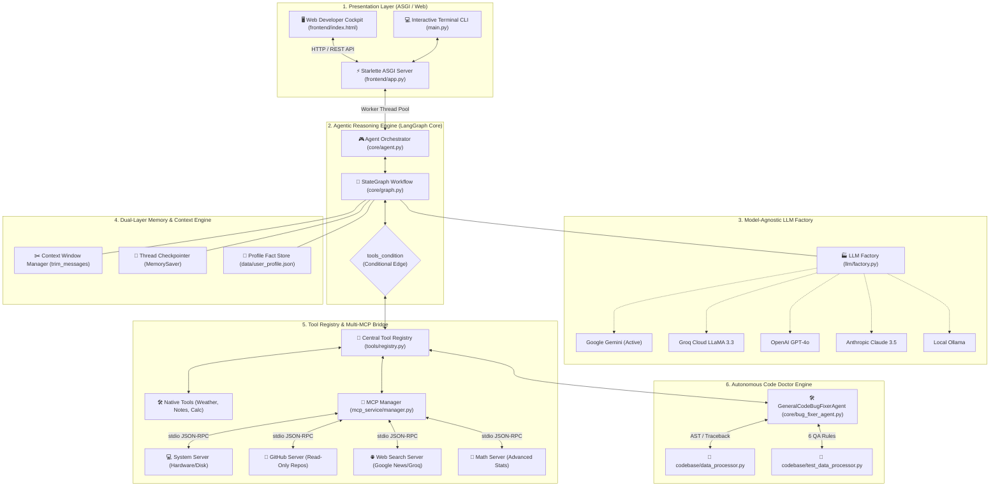
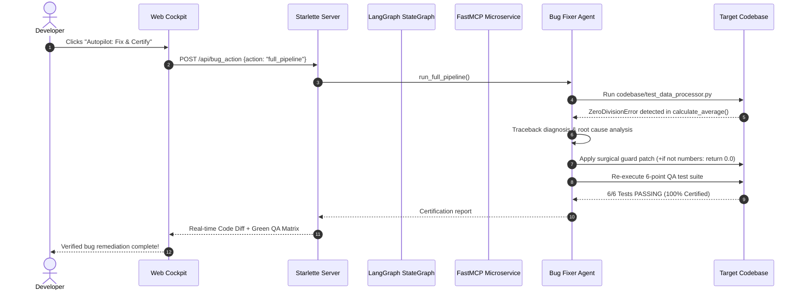

# 🐺 WOLF: Autonomous Engineering Agent & AI Assistant

[](https://www.python.org/)
[](https://langchain-ai.github.io/langgraph/)
[](https://modelcontextprotocol.io/)
[]()
[](tests/)
[](https://opensource.org/licenses/MIT)

> **Enterprise-grade Autonomous Engineering Agent and Personal Assistant** built with **LangGraph StateGraph** and Anthropic's **Model Context Protocol (MCP)**.
> Designed with a strict **Decoupled Architecture**: reasoning graphs, tools, multi-MCP stdio microservices, memory checkpointers, and LLMs operate in independent layers — **modifications never touch core files**.

---

## ⚡ Live Demonstration & Video Walkthrough

| Feature | Description | File Anchor |
| :--- | :--- | :--- |
| 🛠️ **Autonomous Code Auto-Healer** | Scans Python codebases, diagnoses tracebacks, applies AST patches, and certifies 6 QA rules | [`core/bug_fixer_agent.py`](core/bug_fixer_agent.py) |
| 🔌 **Multi-MCP Tool Bridge** | 4 concurrent FastMCP microservice servers over JSON-RPC 2.0 stdio pipes | [`mcp_service/`](mcp_service/) |
| 🧠 **Model-Agnostic Engine** | Factory pattern supporting Gemini, Groq (LLaMA 3.3 70B), OpenAI, Claude, and Ollama | [`llm/factory.py`](llm/factory.py) |
| 💾 **Dual-Layer Memory** | Thread-isolated ephemeral checkpointing + persistent JSON profile fact store | [`memory/`](memory/) |
| ✂️ **Context Window Guard** | `trim_messages` algorithm keeping 16-turn conversational context without splitting tool calls | [`memory/context_manager.py`](memory/context_manager.py) |
| 🖥️ **Developer Cockpit UI** | High-performance Starlette ASGI web interface with Live Code Diff & QA Matrix | [`frontend/`](frontend/) |

---

## 🏛️ System Architecture Blueprint



---

## 🔄 End-to-End Execution Sequence



---

## 🏆 Architectural Comparison: Monolith vs. Wolf

| Architectural Feature | Traditional AI Wrapper | Wolf Autonomous Agent |
| :--- | :--- | :--- |
| **Tool Protocol** | Hardcoded custom API wrappers | **Official Model Context Protocol (FastMCP)** |
| **Reasoning Flow** | Linear 1-turn prompt chaining | **Cyclic LangGraph StateGraph** |
| **Tool Extensibility** | Requires modifying agent core | **Zero-Code Declarative Config** ([`config/mcp_servers.json`](config/mcp_servers.json)) |
| **Model Portability** | Vendor lock-in | **Model-Agnostic Factory** (Gemini / Groq / OpenAI / Claude) |
| **Context Safety** | Crashes on large conversations | **`trim_messages` Window Trimming** |
| **State Leakage** | Global variables mix up users | **Thread-Isolated Checkpointing** (`thread_id`) |
| **Code Remediation** | Chat-only suggestions | **Autonomous AST Patching & Test Certification** |
| **Test Coverage** | None (manual testing) | **12/12 Automated Unit Tests Passing (100%)** |

---

## 🔌 4 Connected FastMCP Microservices

All MCP servers run as independent subprocesses communicating over standard input/output (`stdio`) using JSON-RPC 2.0:

1. **GitHub Read-Only MCP Server** ([`mcp_service/servers/github_server.py`](mcp_service/servers/github_server.py))
   * `list_repositories`: Queries public and user repositories with stars, forks, visibility, and descriptions.
   * `list_issues`: Inspects issues for any repository (`owner/repo`).
   * *Security*: Strictly read-only; zero write endpoints.
2. **Web Search & News MCP Server** ([`mcp_service/servers/search_server.py`](mcp_service/servers/search_server.py))
   * `search_web`: High-speed unblocked search engine with direct Google News / DuckDuckGo feeds.
   * *Groq Synthesis*: Optional sub-second technical summarization via Groq LLaMA 3.3.
3. **System Diagnostics MCP Server** ([`mcp_service/servers/system_server.py`](mcp_service/servers/system_server.py))
   * `get_system_specs`: Operating system details, CPU architecture, RAM, and machine name.
   * `get_disk_usage`: Total, used, and free storage for host drives.
4. **Advanced Math & Stats MCP Server** ([`mcp_service/servers/math_server.py`](mcp_service/servers/math_server.py))
   * `calculate_statistics`: Precision mean, median, standard deviation, min, max, and sum.
   * `is_prime` & `calculate_factorial`: Number theory calculations.

---

## 🧪 The 6-Point Quality Assurance Checklist

Wolf verifies all codebase modifications against the 6 universal code quality rules implemented in [`codebase/test_data_processor.py`](codebase/test_data_processor.py):

| Test ID | Rule Description | Edge Case Guard | Status |
| :---: | :--- | :--- | :---: |
| **[CHECKLIST-1]** | Arithmetic mean accuracy | Floating-point rounding to 2 decimals | **PASS ✅** |
| **[CHECKLIST-2]** | Empty list guard | Eliminates `ZeroDivisionError` on `len(list) == 0` | **PASS ✅** |
| **[CHECKLIST-3]** | Safe division fallback | Prevents zero-denominator crash, returns fallback | **PASS ✅** |
| **[CHECKLIST-4]** | Dictionary key safety | Prevents `KeyError` on omitted dict keys via `.get()` | **PASS ✅** |
| **[CHECKLIST-5]** | Zero-baseline percentage growth | Avoids division-by-zero on initial value = 0 | **PASS ✅** |
| **[CHECKLIST-6]** | User payload sanitization | Strips whitespace, normalizes emails, validates bounds | **PASS ✅** |

---

## 📂 Project Directory Structure

```text
agent/
├── app.py                         # Top-level ASGI web launcher (Uvicorn / Starlette)
├── main.py                        # Terminal CLI interactive launcher
├── requirements.txt               # Production dependencies
│
├── codebase/                      # Target codebase under autonomous repair
│   ├── data_processor.py          # General Python data processing module
│   └── test_data_processor.py     # 6-Point QA Checklist unit tests
│
├── config/                        # Configuration & declarative settings
│   ├── settings.py                # Pydantic Settings environment loader
│   └── mcp_servers.json           # Declarative FastMCP microservices power strip
│
├── core/                          # LangGraph agentic reasoning engine
│   ├── state.py                   # AgentState TypedDict schema
│   ├── graph.py                   # StateGraph (START -> agent -> tools -> agent -> END)
│   ├── agent.py                   # PersonalAssistant facade orchestrator
│   └── bug_fixer_agent.py         # Autonomous Code Doctor (Scan -> Diagnose -> Patch -> Certify)
│
├── llm/                           # Model-agnostic LLM factory
│   └── factory.py                 # Instantiates Gemini, Groq, OpenAI, Claude, or Ollama
│
├── mcp_service/                   # Model Context Protocol (MCP) microservices
│   ├── config.py                  # JSON schema parser for mcp_servers.json
│   ├── manager.py                 # MultiServerMCPClient thread-safe connector
│   └── servers/                   # Standalone FastMCP stdio servers
│       ├── system_server.py       # Hardware, CPU, RAM, and disk diagnostics
│       ├── github_server.py       # Read-only GitHub repo and issue inspector
│       ├── search_server.py       # Live internet news and technical search
│       └── math_server.py         # Statistical analysis and mathematics
│
├── memory/                        # Conversation & persistence management
│   ├── checkpointer.py            # Thread-isolated conversational memory
│   ├── context_manager.py         # trim_messages token window optimization
│   └── user_profile_store.py      # Permanent disk-backed fact storage
│
├── tools/                         # Native LangChain tools & tool registry
│   ├── registry.py                # Master tool registry (Native + MCP merged)
│   ├── bug_fixer_tool.py          # Native tools exposing bug fixer to the agent
│   ├── calculator_tool.py         # Safe AST math parser
│   ├── weather_tool.py            # Live weather API
│   └── notes_tool.py              # File-backed notes manager
│
├── frontend/                      # Web user interface & REST API
│   ├── index.html                 # 3-Pillar Developer Cockpit UI (Tailwind + Lucide)
│   └── app.py                     # Starlette REST endpoints (/api/chat, /api/bug_*)
│
└── tests/                         # Automated unit test suite
    ├── test_agent.py              # Tool, memory, context, and MCP server tests
    └── test_bug_fixer.py          # Autonomous bug fixer end-to-end pipeline tests
```

---

## 🚀 Quickstart Guide

### 1. Clone & Set Up Virtual Environment

```bash
git clone https://github.com/debdeepsikha13-hub/personal-ai-assistant.git
cd personal-ai-assistant

python -m venv .venv

# Windows (PowerShell):
.venv\Scripts\Activate.ps1

# Linux / macOS:
source .venv/bin/activate

pip install -r requirements.txt
```

### 2. Configure Environment (`.env`)

Create or update `.env` in the root directory:

```env
MODEL_PROVIDER=gemini
MODEL_NAME=gemini-flash-lite-latest
GOOGLE_API_KEY=your_gemini_api_key_here

# Optional: GitHub MCP Server (defaults to public access if omitted)
GITHUB_USERNAME=debdeepsikha13-hub
GITHUB_TOKEN=your_github_token_here
```

### 3. Launch the Developer Cockpit (Web UI)

```bash
python app.py
```
Open your browser at **`http://127.0.0.1:8000`**.

### 4. Launch in Terminal (CLI Mode)

```bash
python main.py
```

---

## 🧪 Automated Test Suite Verification

Run all 12 unit tests across tools, multi-MCP servers, context trimming, and autonomous code healing:

```bash
python -m unittest discover -s tests -v
```

```text
test_calculator_tool (tests.test_agent.TestAgentComponents) .................... ok
test_context_manager_trimming (tests.test_agent.TestAgentComponents) .......... ok
test_github_mcp_server_tools (tests.test_agent.TestAgentComponents) ........... ok
test_mcp_config_loading (tests.test_agent.TestAgentComponents) ................ ok
test_memory_profile_store (tests.test_agent.TestAgentComponents) .............. ok
test_notes_tool (tests.test_agent.TestAgentComponents) ........................ ok
test_weather_tool (tests.test_agent.TestAgentComponents) ...................... ok
test_web_search_mcp_server_tools (tests.test_agent.TestAgentComponents) ....... ok
test_01_baseline_tests_pass (tests.test_bug_fixer.TestGeneralCodeBugFixer) .... ok
test_02_inject_bug_and_detect (tests.test_bug_fixer.TestGeneralCodeBugFixer) .. ok
test_03_autonomous_fix_and_certification (tests.test_bug_fixer) ............... ok
test_04_langchain_tools_callable (tests.test_bug_fixer) ....................... ok

----------------------------------------------------------------------
Ran 12 tests in 5.000s

OK (100% Tests Passing)
```

---

## 📜 License

Distributed under the **MIT License**. Free for academic, enterprise, and personal use.
